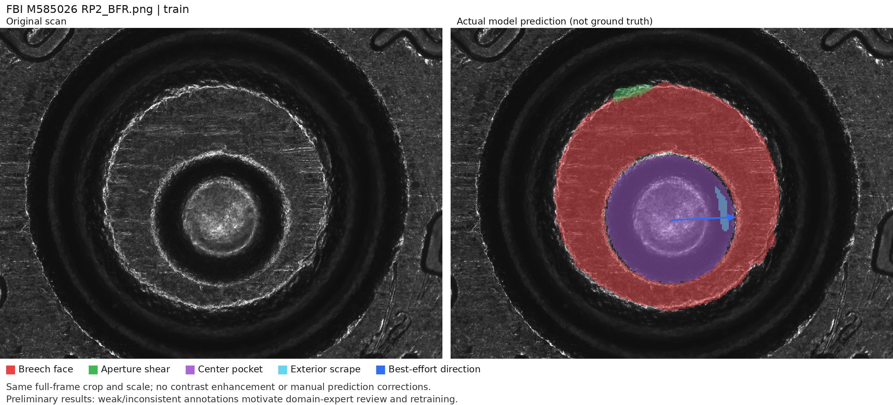

# Overall strategy for the submission

This project is a submission for a ballistics analysis challenge. As I am not a machine-learning or ballistics specialist, my focus was to build a tool that helps domain experts improve the data and algorithms over time.

Through the web interface, experts can inspect scans, correct masks, curate training examples, and retrain the estimator as their annotations and methods improve.

# Cartridge Case Masking Workbench

A local browser workbench for reviewing pixel masks on fired cartridge-case microscopy PNGs. Compare an estimate with the original scan, correct masks and arrows at native resolution, and save revisions without changing the original. The CPU estimator combines the unchanged Run #3 mask baseline with a best-effort ordered-arrow estimator. Every successful estimate proposes an arrow, including when the visible support is weak; experts can correct or reject it before saving.

Docker packages the application and its dependencies so the same tool can run on a local machine or be deployed to a network location and accessed through a browser. The goal is to make it easy to deploy wherever it is needed, without requiring users to configure a development environment.

**Release status:** Research/development release with 48 real **9×19 mm (9 mm Luger)** reflectance-microscopy scans and the fitted baseline. Scan images follow NIST's published data reuse terms; annotations and the checkpoint have separate attribution and licensing in [Data, annotation, and model terms](docs/data-licenses.md). Annotation quality remains under review. This is a review aid, not a validated forensic tool or a published benchmark.

**New to the app? [Read the illustrated user guide](docs/user-guide.md)** for a tour of the interface, mask and arrow editing, saving versus approval, training changes, safe scan intake, and workspace backups.

**Research findings:** [Multi-caliber pilot: tests, results, and recommended approach](docs/research/multi-caliber-pilot.md) reports the private .40 S&W transfer experiment, coarse-reference measurements, limitations, and next steps. The additional scans and experimental outputs are not part of the public starter or its supported scope.

## Methodology

1. **Prepare real scans and annotations.** The current training snapshot contains 30 NIST 9×19 mm (9 mm Luger) reflectance-microscopy scans across 15 source groups. We matched Dundee reference masks to the scan and view, aligned them to native dimensions, and combined retained or adapted masks with GPT-assisted drafts and subsequent workbench review. The original scan pixels are preserved; annotations are separate native-resolution binary layers and ordered arrow endpoints. See [data sources and annotation preparation](starter/README.md#how-the-training-masks-were-made).
2. **Freeze reviewed training inputs.** The Go app stores images, revision history, and explicit approvals in SQLite. Fitting uses a versioned snapshot of included training cases and eligible approved labels, not the latest unsaved edits or held-out cases. Saving a draft, approving it, and retraining are separate actions.
3. **Fit a local CPU baseline.** On a reduced grayscale grid, we extract position, intensity, and multiscale texture features. A histogram gradient-boosted classifier is fitted separately for each learnable mask region, with a spatial prior derived from training masks. Prediction smooths probabilities, thresholds them using that prior, removes small components, and resizes the binary masks to native dimensions. This is our own baseline built with standard Python libraries, not a pretrained cartridge-case neural network. See [estimator details](python/README.md#what-the-worker-does).
4. **Review predictions without overwriting annotations.** The bundled mask checkpoint is the fitted Run #3 artifact, displayed as Run #1 in a fresh workspace. **Run new estimate** creates an unsaved mask-and-arrow preview; it does not retrain or replace saved revisions. Arrow estimation uses predicted pocket/scrape geometry where available and a compact direction/length prior learned from the 17 annotated training arrows otherwise. New training runs learn that prior from the current approved snapshot. GPT was used during annotation preparation, not during local fitting or inference.

**Current results and data limits:** The current training annotations are weak and inconsistent, particularly for fine marks and drag direction, limiting what the estimator can learn. The predictions are preliminary results, not expert ground truth. This is why the workbench lets ballistics domain experts correct annotations, build a more consistent training dataset, and retrain the estimator over time. We publish the current outputs as they are rather than withholding imperfect results; they can be updated as the data and methods improve.

## Assumptions and edge cases

- **Scope:** The present cohort is 9×19 mm reflectance microscopy, not mixed-caliber photographs or 3D surface scans. Other calibers, lighting, orientations, fields of view, and instruments are outside the established scope; position features and spatial priors can fail when framing changes.
- **Target meanings:** Four regions are learned: breech-face impression, aperture shear, the center pocket (`firing_pin_shear`), and the exterior scrape (`firing_pin_impression`). These last two names follow this project's label convention; a pocket-internal rim is not an exterior scrape. Drag direction is a separate ordered tail-to-tip annotation, not a fifth mask.
- **Unknown is not absent:** `absent`, `indeterminate`, and `not_annotated` are distinct. Unknown labels are excluded from fitting rather than used as negatives. If no mask is emitted, that is an abstention, not verified absence; the editor preserves unpredicted mask targets. The arrow is always a best-effort prediction, not a verified direction or an instruction to approve an uncertain reference label.
- **Small and ambiguous marks:** Downsampling and component cleanup can miss thin or tiny marks, and boundaries can overfill or drift. A reviewed positive that disappears on the fitting grid is skipped and recorded, not relabeled absent. Shadows, rims, and unclear scrape or arrow geometry need further review rather than a forced positive label.
- **Data quality remains under review:** The frozen labels include reviewed AI-assisted and adapted reference annotations, not an independently established forensic ground truth. Workbench approval records a workflow decision, not expert certification. Correcting a draft alone does not update the fitted checkpoint; corrected supervision must be approved and a new run fitted before predictions can reflect it.
- **Verification is not accuracy:** Checksum checks, restarts, and matching predictions verify packaging and software behavior. Estimates on the bundled training scans do not establish generalization. The [grouped development evaluator](training/evaluation/README.md) refits on separate source-group complements and scores reserved groups; this is development evaluation, not an independent test-set or forensic-validation claim.

## Start with Docker

The intended hosts are **Windows x86-64** with [Docker Desktop](https://docs.docker.com/desktop/setup/install/windows-install/) running **Linux containers** (recommended: the WSL 2 backend; see the prerequisites below), and **Linux x86-64** with [Docker Engine](https://docs.docker.com/engine/install/) and the Compose plugin. No GPU or host Python is required; the container uses a pinned Python 3.14 runtime.

The root [`requirements.txt`](requirements.txt) is the discoverable Python dependency entry point; it includes the canonical pinned [`python/requirements.txt`](python/requirements.txt). Docker installs that canonical file inside the container, so Docker users do not need to install Python dependencies on the host. See the [Python estimator setup](python/README.md#go-to-worker-interface) for optional local worker use.

### Windows prerequisites (recommended WSL 2 setup)

**WSL 2 (Windows Subsystem for Linux 2) is required for Docker Desktop's recommended WSL backend, not for the masking code itself.** Docker Desktop can also run Linux containers using another supported backend, such as Hyper-V. If the app already runs that way, you do not need to change backends or reset your data.

1. Check the [Docker Desktop Windows system requirements](https://docs.docker.com/desktop/setup/install/windows-install/#system-requirements), including a supported Windows version and hardware virtualization enabled in BIOS/UEFI.
2. In **PowerShell**, check the installed WSL package and distributions:

   ```powershell
   wsl --version
   wsl --list --verbose
   ```

   For the WSL backend, Docker currently requires **WSL package version 2.1.5 or later**, with the latest recommended. The distribution list's **VERSION** column separately shows WSL **1** or **2**; when Docker Desktop uses WSL 2, its `docker-desktop` distribution should show **2**. No Ubuntu or other personal Linux distribution is needed.
3. If WSL is missing, open **PowerShell as Administrator**, install it without an extra Linux distribution, then **restart Windows**:

   ```powershell
   wsl --install --no-distribution
   ```

   To update an existing WSL installation, run `wsl --update` and restart if prompted. If these commands are unavailable or setup reports a virtualization problem, follow [Microsoft's WSL installation guide](https://learn.microsoft.com/en-us/windows/wsl/install) and [command reference](https://learn.microsoft.com/en-us/windows/wsl/basic-commands).
4. Install/start [Docker Desktop for Windows](https://docs.docker.com/desktop/setup/install/windows-install/), select the **WSL 2 backend**, and use **Linux containers**, not Windows containers. In versions that show the option, enable **Settings → General → Use WSL 2 based engine**; some installations select it automatically and do not show that checkbox. Docker provides its own Linux environment—you do not install Python, Go, Node, or the app inside Ubuntu.

See [Docker's official WSL 2 guide](https://docs.docker.com/desktop/features/wsl/) for the full setup. Once Docker Desktop is running, use the same launch command below from PowerShell in the repository directory; there is no separate Windows image.

### Launch the workbench

With the verified starter bundle at `starter/full-bundle/`, run this from the repository root using a local Docker builder:

```sh
docker compose up --build -d
```

Open [localhost:8787](http://localhost:8787/). A fresh workspace has all 48 real cohort scans (30 train, 6 validation, 12 test), with only the 30 training cases approved and included, and the unchanged fitted Run #3 model, so **Run new estimate** works without retraining. The estimate is an unsaved preview until you save or approve it. An existing workspace is preserved on upgrade.

Stop with `docker compose down`. The named volume mounted at `/data` keeps your work; do not add `-v` unless you intend to delete it.

### Data reset

**A data reset permanently deletes the selected workspace volume**, including imported cases, saved edits, revision history, and training runs. Back up anything you want to keep. A normal restart or rebuild is not a reset.

From the repository root, using the same Compose project and volume settings you use to start the app, stop the app and remove its volume:

```sh
docker compose down --volumes
```

Once that succeeds, rebuild and start the app:

```sh
docker compose up --build --wait
```

Prefix both commands with `sudo` if your Linux Docker setup requires it. On startup, the app creates a fresh workspace from the bundled starter data. Open [localhost:8787](http://localhost:8787/). See [Workspace and backups](docs/deployment.md#workspace-and-backups) for how to keep the existing volume instead.

## Sample outputs

[See three original-versus-prediction examples](docs/sample-outputs.md), including one training scan and two validation scans from different source groups. They were run through the unchanged released mask checkpoint and the best-effort arrow estimator, without manually correcting the outputs. The page includes native mask files, ordered arrow coordinates, provenance, and reproduction instructions. These are actual preliminary results, not independently scored accuracy claims.

[](docs/sample-outputs.md)

## Repository map

| Folder | What is inside |
| --- | --- |
| [`cmd/`](cmd/) | `reviewapp/`: Go executable entry point, startup flags, local-server setup, and startup tests. |
| [`deployment/`](deployment/) | Container bootstrap and seed-part assembly scripts, independent starter checksum pins, and deployment tests. |
| [`docs/`](docs/) | The illustrated [user guide](docs/user-guide.md), its screenshots in `images/user-guide/`, architecture diagrams, deployment/backups, and asset-specific license notices. |
| [`internal/`](internal/) | `reviewapp/`: Go API, SQLite storage, scan intake, annotation revisions/approvals, training snapshots, worker orchestration, and backend tests. |
| [`python/`](python/) | CPU training/inference workers, multiscale model implementation, dependency requirements, and estimator documentation. |
| [`starter/`](starter/) | Runtime seed and credits. `full-bundle/` holds immutable SQLite transport parts, checksums, and the fitted model used to initialize a **fresh** workspace; it is not the live editable database. |
| [`tests/`](tests/) | Python worker integration tests. Component-specific tests also live beside Go, frontend, deployment, and evaluation code. |
| [`training/`](training/) | Data attribution, verification, and grouped evaluation. `dataset/manifest.jsonl` inventories **all 48 scans** with image/mask assets; `dataset/train.jsonl` is the explicit **30-case approved training export**, not the full mixed-split inventory. |
| [`web/`](web/) | React browser editor, styles, frontend build configuration, unit tests in `test/`, and browser QA scripts in `qa/`. |

At the root, [`Dockerfile`](Dockerfile) builds the app and verifies the starter seed; [`compose.yaml`](compose.yaml) configures the local service and persistent named volume; [`LICENSE`](LICENSE) contains the software's MIT license (data, annotations, and model have [separate terms](docs/data-licenses.md)). `go.mod` and `go.sum` pin Go dependencies.

**Live Docker data is outside this repository dataset:** the named volume mounted at `/data` stores imported scans, saved revisions, and run/checkpoint files. Editing in the app does not update `starter/` or `training/dataset/`. Generated local workspaces, dependency/build directories, and temporary files are not additional shipped source folders. See [Workspace and backups](docs/deployment.md#workspace-and-backups).

## Documentation

| Component README | What it covers |
| --- | --- |
| [Browser editor](web/README.md) | How to preview estimates, edit masks and arrows, compare revisions, and save or approve changes. Also covers local React development and testing. |
| [Python estimator](python/README.md) | How the CPU model trains and predicts masks, how Go calls the Python worker, and which prior work informed the method. |
| [Training data and evaluation](training/README.md) | The approved training snapshot, data sources, and how to reproduce the grouped model tests. |
| [Starter cases and data credits](starter/README.md) | Which scans, annotations, and model are used for a fresh workspace, where they came from, and what can be redistributed. |

- [System architecture](docs/architecture.md#system-overview) — Mermaid diagrams showing how the browser, Go API, Python worker, and workspace fit together.
- [Deployment](docs/deployment.md) — Docker setup, upgrades, troubleshooting, and managing the persistent workspace.

## License and data credits

The original workbench software is licensed under [MIT](LICENSE). Third-party dependencies keep their own licenses. The scan images follow NIST's published reuse terms; local annotation contributions and the fitted checkpoint are distributed under CC BY 4.0 with Dundee source credit. MIT does not replace these asset-specific terms. See [Data, annotation, and model terms](docs/data-licenses.md) for permissions, required notices, and the release-review limits.

The training annotations combine locally reviewed GPT-assisted drafts with retained or edited University of Dundee masks. Dundee's masks are credited under [CC BY 4.0](https://creativecommons.org/licenses/by/4.0/), including where we resized or edited them. See the [starter data guide](starter/README.md#dundee-mask-attribution) for the full citation, changes, and separate terms for the other assets.
