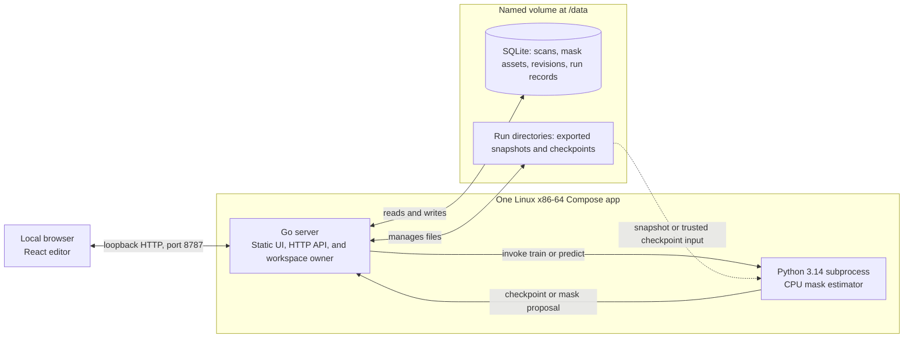
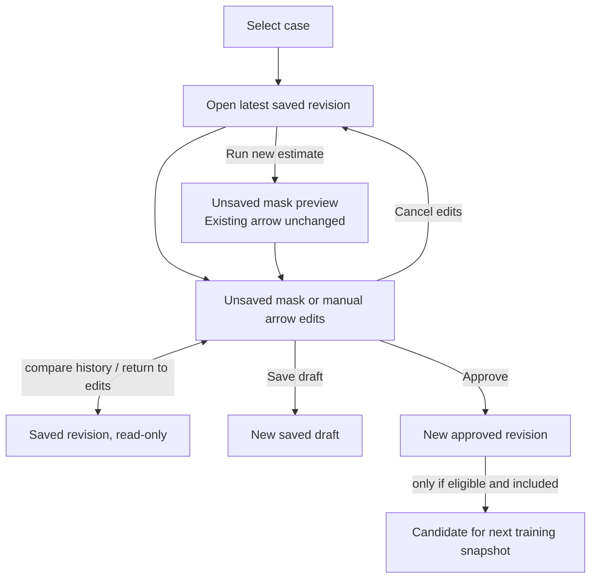
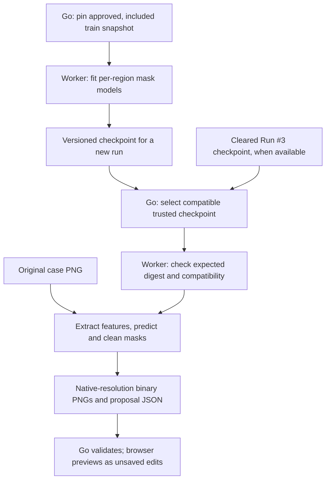
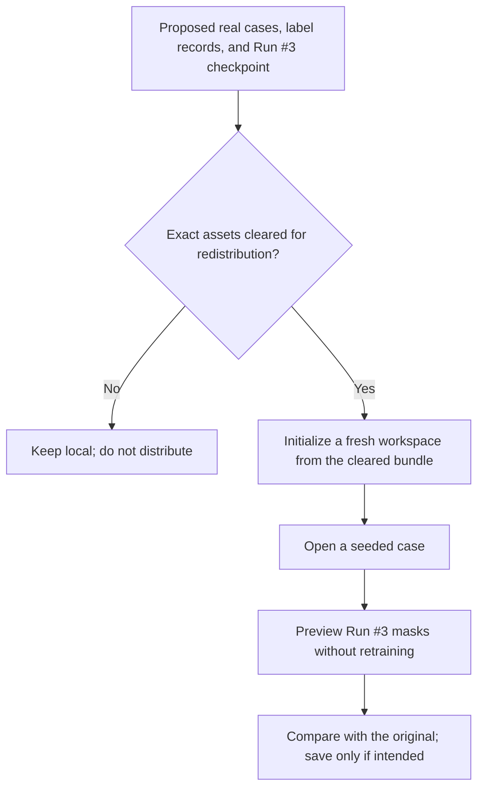

# Architecture

These diagrams describe the intended seeded Compose setup. The starter assets and their redistribution terms are still under review.

> **VS Code preview:** VS Code 1.121 and later [render Mermaid in the built-in Markdown preview](https://code.visualstudio.com/updates/v1_121/#_mermaid-diagrams-in-markdown-preview-and-notebooks). If diagrams flash and disappear, disable the older **Markdown Preview Mermaid Support** extension (`bierner.markdown-mermaid`) for this workspace, keep **Mermaid Markdown Features** enabled, and reload the window.

## System overview

The browser does not train or generate labels. Go owns the database and run records. Python reads the files Go supplies and writes its requested output files; it does not edit SQLite. The app is intended for one local user, not network hosting. See [Deployment](deployment.md).

## Browser editor flow

Inference does not create a saved revision or replace training approval. The [browser editor guide](../web/README.md) describes these controls.

## Python worker flow

A refit is a separate run, not a way to recreate the original fitted Run #3 checkpoint. See the [Python estimator guide](../python/README.md) for the method and CLI.

## Starter workflow

The starter is a sanitized full 48-case inventory, not a copy of a private workspace. Only the frozen 30 train cases are approved and included; 6 validation and 12 test cases have unapproved source revisions and are not an independently blind evaluation set. See [Starter cases and credits](../starter/README.md).
