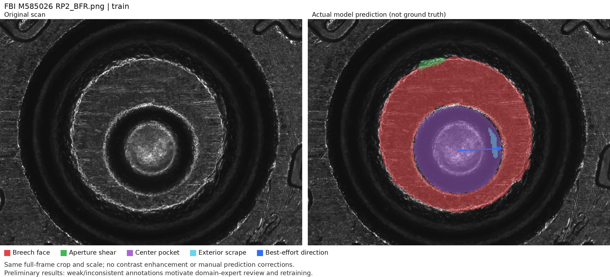
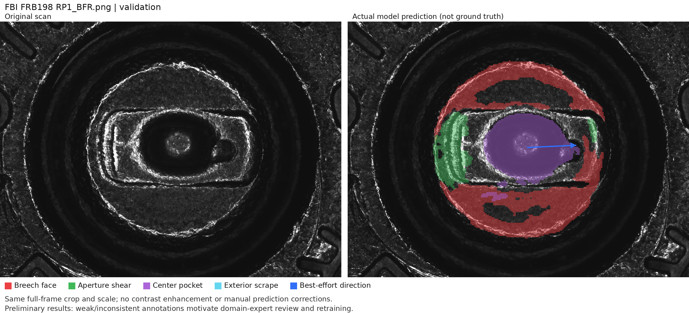
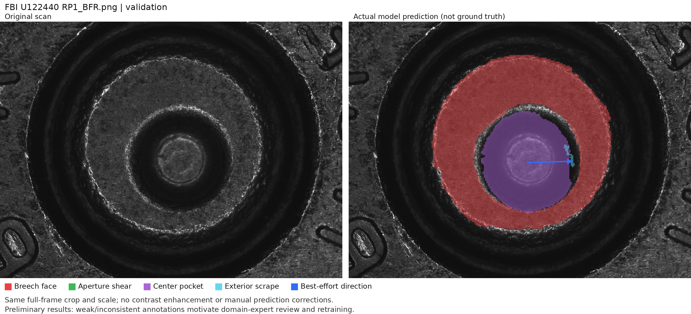

# Sample outputs: current baseline results

[Workbench README](../README.md#sample-outputs) · [Estimator](../python/README.md) · [Machine-readable results](sample-outputs-results.json)

These are **actual predictions from the existing released mask checkpoint plus the best-effort arrow estimator**, not saved reference labels or manually corrected predictions. The original scan is on the left and the generated overlay on the right, with identical full-frame crop and scale and no contrast enhancement. Native binary masks and ordered arrow coordinates are linked below.

**Why these results are preliminary:** the current training annotations are weak and inconsistent, especially for fine marks and drag direction. This limits what the estimator can learn. We publish the current results—including imperfect boundaries and directions—as a starting point, not expert ground truth. The purpose of the workbench is for ballistics domain experts to correct those annotations, build a consistent dataset and retrain as the data and methods improve. Better accuracy is not claimed merely because a prediction is emitted.

## Inputs and method

- All three inputs are existing public **9×19 mm (9 mm Luger) reflectance-microscopy scans**. No assignment PDF, exercise image or new experimental scan is included.
- Selection was fixed before looking at outputs: the first training entry and the first validation entry from each of the first two distinct validation source groups, in existing manifest order. This is not a best-results selection.
- The training example was used for fitting. The two validation examples were not used for fitting the mask model or the bundled arrow prior, but are now exposed as illustrations. No model was tuned on these examples, and no test-set accuracy is reported.
- The mask model is the unchanged original Run #3, displayed as Run #1 in a fresh workspace. Its checkpoint SHA-256 is `a4056cde70e06dc75314ca295f9dafa58e479c5b4b220176e708559a5e225a21`.
- The compact arrow prior was fitted from the 17 ordered arrows in the existing approved 30-case training export. The estimator uses predicted purple pocket / cyan exterior-scrape geometry where available, with learned fallback geometry otherwise. Every successful estimate returns its best-effort arrow; it is not a verified impact point or direction.
- Colors follow the app: **red** breech face, **green** aperture shear, **purple** center pocket (`firing_pin_shear`), **cyan** exterior scrape (`firing_pin_impression`), **blue** directed arrow. An un-emitted mask is not proof of absence.

## 1. FBI M585026 RP2 — training example

[](images/sample-outputs/01-fbi-m585026-rp2-bfr.png)

Used for fitting; this is a demonstration of the fitted model, not evidence of generalization. Source study: **PopStat Sig Sauer**; measurement creator: **Nicole Silver**.

[Original scan](../training/dataset/images/FBI%20M585026%20RP2_BFR.png) · [Native generated masks](sample-outputs/01-fbi-m585026-rp2-bfr/) · [Proposal and ordered arrow coordinates](sample-outputs/01-fbi-m585026-rp2-bfr/proposal.json)

## 2. FBI FRB198 RP1 — validation example

[](images/sample-outputs/02-fbi-frb198-rp1-bfr.png)

Not used for fitting the released model or arrow prior. Source study: **PopStat Glock**; measurement creator: **Nicole Silver**. Inspect the result as produced; no boundary or direction was repaired for this figure.

[Original scan](../training/dataset/images/FBI%20FRB198%20RP1_BFR.png) · [Native generated masks](sample-outputs/02-fbi-frb198-rp1-bfr/) · [Proposal and ordered arrow coordinates](sample-outputs/02-fbi-frb198-rp1-bfr/proposal.json)

## 3. FBI U122440 RP1 — another validation source group

[](images/sample-outputs/03-fbi-u122440-rp1-bfr.png)

Not used for fitting the released model or arrow prior, and from a different source group than example 2. Source study: **PopStat Sig Sauer**; measurement creator: **Nicole Silver**. These examples are outputs, not an independently reviewed benchmark.

[Original scan](../training/dataset/images/FBI%20U122440%20RP1_BFR.png) · [Native generated masks](sample-outputs/03-fbi-u122440-rp1-bfr/) · [Proposal and ordered arrow coordinates](sample-outputs/03-fbi-u122440-rp1-bfr/proposal.json)

## Reproduce a prediction

For offline use, create a Python 3.14 environment with the root [`requirements.txt`](../requirements.txt). Docker users already have the dependencies. From the repository root:

```sh
python python/multiscale_worker.py predict \
  --model starter/full-bundle/review.sqlite.runs/1/checkpoint.json \
  --image 'training/dataset/images/FBI M585026 RP2_BFR.png' \
  --out .local/sample-output \
  --expected-model-sha256 a4056cde70e06dc75314ca295f9dafa58e479c5b4b220176e708559a5e225a21
```

The output contains `proposal.json`, including native `[x,y]` tail→tip coordinates and method/fallback metadata, plus each emitted binary mask PNG (foreground 255, background 0) at the input's **2592×1944** dimensions. No saved workspace labels or approvals are changed by this command. The [results receipt](sample-outputs-results.json) records input, model, arrow-prior, proposal, mask and figure hashes for these published examples. Re-running later software may change results even when the original mask checkpoint is retained; use the same repository revision to reproduce this version.

## Credits, terms and image modifications

**Scans:** Xiaoyu Alan Zheng (2019), *NIST Ballistics Toolmark Research Database*, National Institute of Standards and Technology, [DOI 10.18434/M32021](https://doi.org/10.18434/M32021). Study and measurement-creator credits are listed per example above. NIST's [reuse terms, warranty and nonendorsement notices](data-licenses.md#nist-scan-images) apply. The packaged source scans preserve pixels but omit PNG text/timestamp chunks; the paired figures resize both views equally, add prediction colors/arrows, headers and a legend, without enhancing the scan or editing the predictions.

**Model and mask lineage:** Cartridge Case Masking Workbench contributors; Muthu Rama Krishnan Mookiah, Roberto Puch-Solis, Farhan Tanvir Santo and Busayo Ajala (creators), Niamh Nic Daeid (supervisor), University of Dundee (2024), *Segmentation masks for breech and firing-pin areas for a NIST dataset of firearm cartridge case Images*, [DOI 10.15132/10000262](https://doi.org/10.15132/10000262), **[CC BY 4.0](https://creativecommons.org/licenses/by/4.0/)**. Training combined retained/adapted Dundee masks with locally reviewed AI-assisted annotations; Dundee did not supply these predicted outputs, fine-mark labels, or directed arrows. The checkpoint, learned arrow parameters and generated mask/arrow contributions follow the [project model/output terms](data-licenses.md#annotations-and-fitted-model); the underlying scans retain their separate terms. No source institution endorses these predictions.
