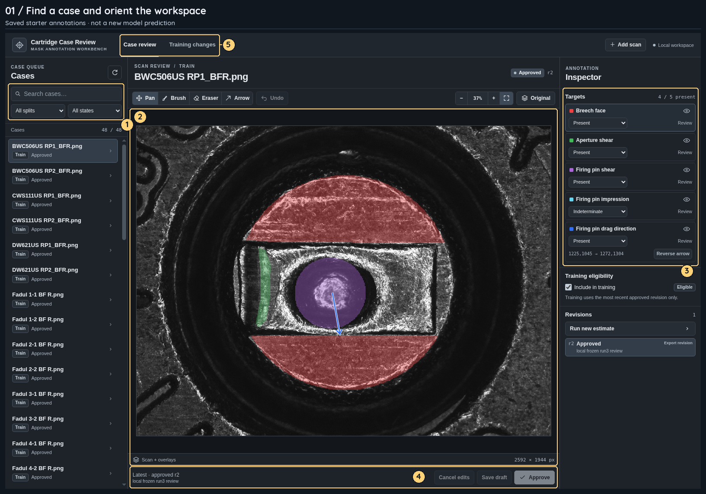
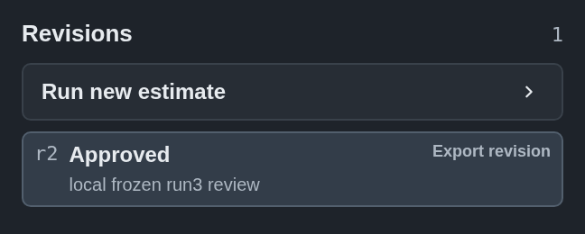
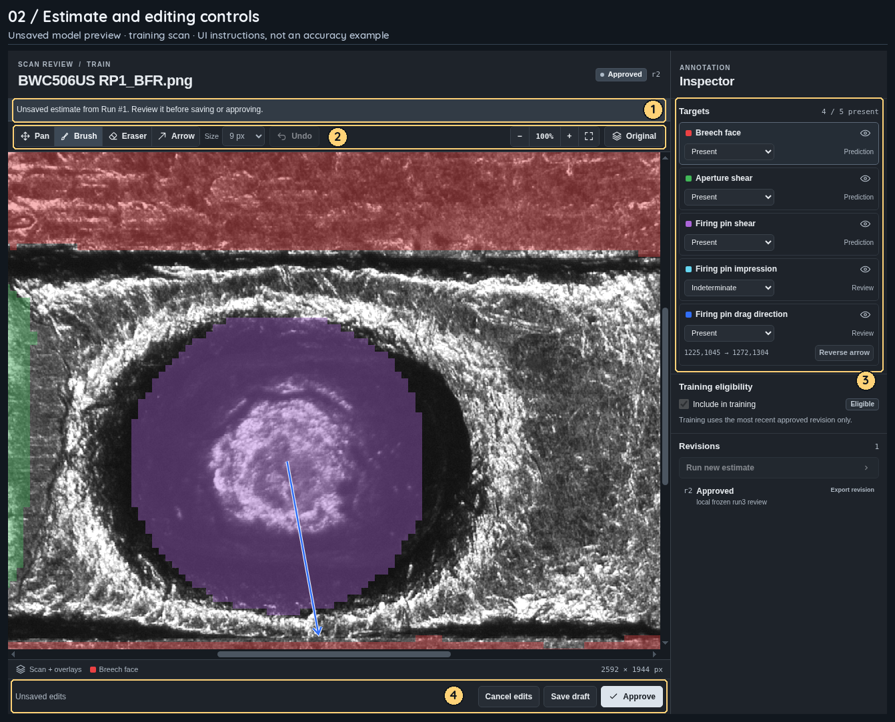
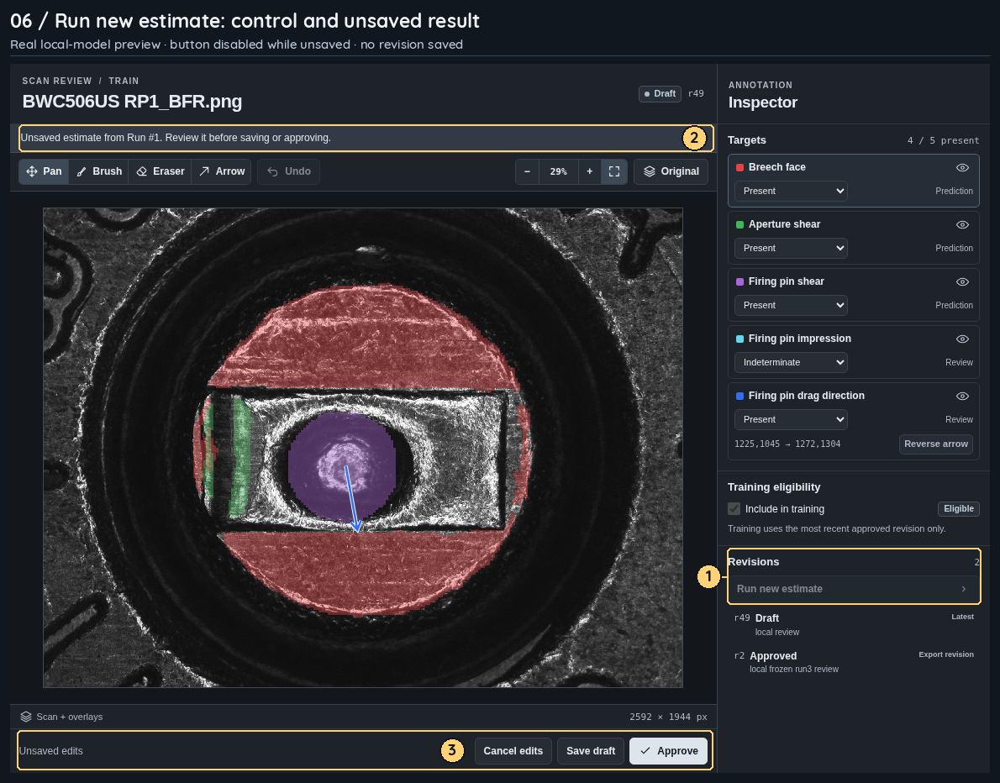
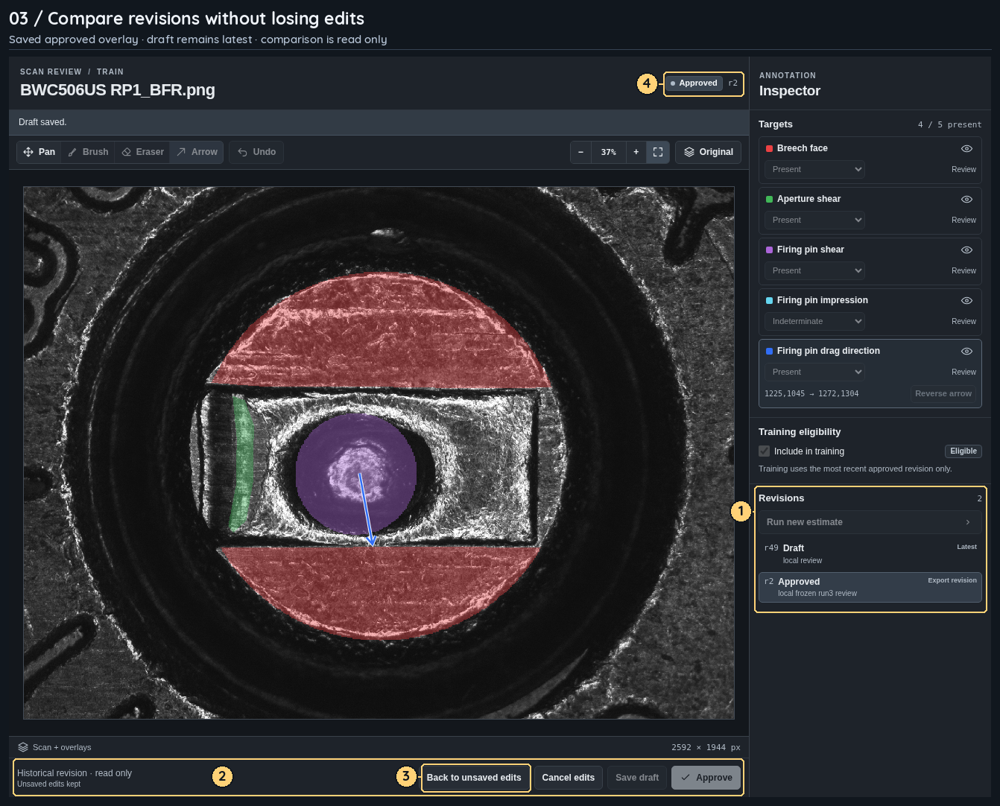
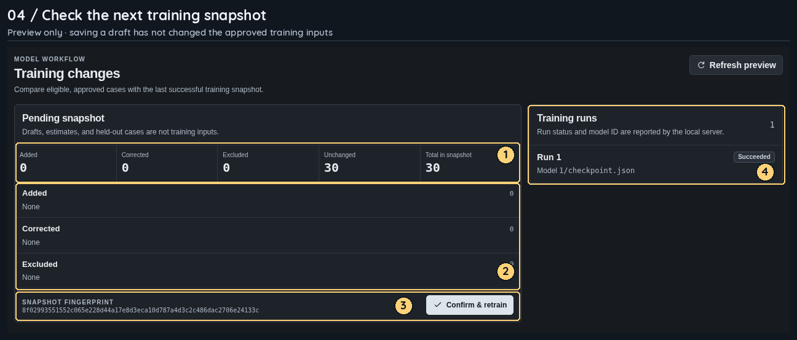
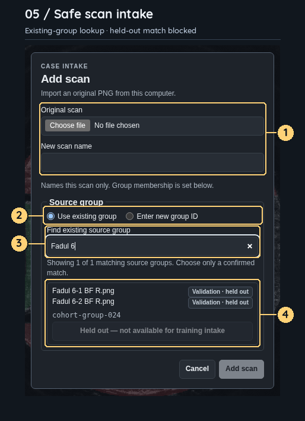

# Using the Cartridge Case Masking Workbench

[Workbench README](../README.md) · [Install and run](../README.md#start-with-docker) · [Deployment and backups](deployment.md)

Use this guide after opening the local app, normally at [localhost:8787](http://localhost:8787/). A fresh starter workspace has 48 scans and a fitted model; **you do not need to retrain to try an estimate**.

> **Read the state, not just the colors.** A saved label, an unsaved estimate, and an approved training revision are different things. Approval is a workflow decision, not forensic certification. These screenshots explain the interface; they do not validate mask boundaries or demonstrate independent model accuracy. See the separate [actual sample outputs](sample-outputs.md) for original-versus-prediction comparisons.

**Jump to:** [Find a case](#find-a-case) · [Inspect and edit](#inspect-and-edit) · [Run new estimate](#run-new-estimate-button) · [Save and compare](#save-approve-and-compare) · [Training](#review-training-changes) · [Add scan](#add-a-scan-safely) · [Export and persistence](#export-persistence-and-reset)

Figures are real app captures; most have numbered outlines added. The estimate-button close-up is an unannotated crop. They predate automatic arrows; current estimates also propose a best-effort arrow rather than retaining the manual arrow shown in the older captures. Open a figure for its full-resolution version. [Image credits and modifications](#screenshot-credits) apply to every figure.

## Find a case

*Figure 1 — Saved starter annotations on a training scan, not a fresh prediction. **1** Search and filters; **2** scan viewer; **3** target palette and statuses; **4** save state and actions; **5** review/training tabs. [Credits](#screenshot-credits).*

1. In **Cases**, search by scan name. Combine the split filter (**Train**, **Validation · held out**, **Test · held out**) with the review-state filter. The count is matching cases / all cases.
2. Choose **Needs review** for cases without an approval matching their latest revision. **Has approval** also includes a case with a newer unapproved draft. **Excluded** means a training case whose inclusion is switched off, not every held-out case.
3. Click a queue row. Check its split, revision badge, and the state below the viewer before editing. Filtering the queue does not itself switch the open scan.

Validation/test cases may be reviewed, but their **Include in training** checkbox is disabled. A held-out annotation is not eligible training supervision, even if reviewed or approved.

## Inspect and edit

1. Toggle **Original** to hide all annotations and inspect the unmodified scan. Toggle it off to return to overlays at the same view. Original-only mode disables painting and arrow editing; it does not delete annotations.
2. Use **+ / −** to zoom, click the percentage for **100%**, or use the fit icon to fit the scan. At an enlarged view, select **Pan** and drag to move around. There are no documented wheel-zoom or drawing-tool shortcuts to learn.
3. Click a target name in the inspector to select it. Its eye button hides/shows that overlay without changing its status or saved pixels. Selecting a mask normally activates **Brush**; it preserves **Eraser** if that tool is already selected.
4. Paint with **Brush**, remove pixels with **Eraser**, and adjust **Size** in native image pixels. For a one-pixel correction, choose **1 px** and zoom in. **Undo** or **Ctrl+Z / ⌘Z** undoes a recent brush/eraser stroke—not arbitrary status, arrow, or estimate changes. Use **Cancel edits** to discard the whole unsaved edit session.

### Targets and uncertainty

| Target in the palette | Color | Meaning in this project |
| --- | --- | --- |
| Breech face | Red | Breech-face impression region |
| Aperture shear | Green | Aperture-shear region |
| Firing pin shear | Purple | Center pocket (`firing_pin_shear`) |
| Firing pin impression | Light blue | Exterior scrape (`firing_pin_impression`), not a pocket-internal rim |
| Firing pin drag direction | Blue | Separate ordered tail → tip, not a mask |

Choose a status for **each** target:

- **Present:** supported region or direction. A mask needs at least one pixel; an arrow needs two distinct endpoints.
- **Absent:** reviewed and judged not present; this can supply a negative training label.
- **Indeterminate:** inspected but uncertain. Do not force a boundary or direction.
- **Not annotated:** no annotation judgment recorded.

**Unknown is not absent.** Indeterminate/not-annotated labels are excluded from fitting rather than treated as negatives. A hidden overlay is not an absent target. Painting adds pixels and sets that mask to Present; erasing the final pixel does not decide absence for you—change the status before saving an empty mask.

For a defensible direction, select **Arrow** (or the drag-direction target). With no arrow, drag from tail to tip. For an existing arrow, drag its tail or tip handle; dragging away from the tail adjusts the tip while retaining the tail. **Reverse arrow** swaps endpoints. The inspector reports tail → tip in native pixel coordinates. Leave the status Indeterminate when direction is unsupported.

## Preview an estimate

### Run new estimate button

*Figure 2 — The actual **enabled Run new estimate** button before clicking it. Find it under **Revisions** in the right Inspector; scroll inside that panel if necessary. This is a direct crop of the running app, not a recreated control. [Credits](#screenshot-credits).*

Click this button to run the **already fitted model** on the open scan. It does **not** retrain. The result is an unsaved preview until you choose **Save draft** or **Approve**; the images below show that later state.

*Figure 3 — **1** Explicit unsaved-estimate notice; **2** drawing and view controls; **3** per-target status/origin, including retained uncertainty and a manually reviewed arrow; **4** unsaved state and save actions. This is a UI-state illustration on a training scan, not an accuracy example. [Credits](#screenshot-credits).*

*Figure 4 — **1** The **Revisions → Run new estimate** control in the right Inspector; it is disabled here because the estimate has already produced unsaved edits. **2** The real unsaved-estimate notice. **3** Unsaved state and the separate cancel/save/approve actions. The saved revision list is unchanged. This is a UI-state illustration on the same public training scan, not an accuracy example. Figure 3 remains the editing-controls view. [Credits](#screenshot-credits).*

1. Locate **Revisions** below **Training eligibility** in the right **Inspector**, then find **Run new estimate** (Figure 2; also Figure 4, callout 1). If it is below the viewport, scroll **inside the Inspector panel**, not the scan viewer.
2. Start from the **latest saved revision**, in editable view, with no unsaved edits. The button is disabled while edits are unsaved or a read-only comparison is open. Save or **Cancel edits** first; when comparing, return with **View latest** or **Back to unsaved edits**, then resolve any retained edits.
3. Click **Run new estimate**. It runs the **already fitted local CPU model** against this scan and the open base revision: **this is inference, not retraining**. The result stays in the browser's edit buffer; no saved revision is created until you choose **Save draft** or **Approve**.
4. Check the **Unsaved estimate from Run #…** notice (callout 2). Emitted Present predictions replace those targets in the edit buffer. Unpredicted mask targets are preserved—not erased or marked Absent. Every successful estimate also proposes a best-effort arrow, using learned fallback geometry when support is weak; it can replace an existing arrow in the unsaved buffer. Correct it or mark it Indeterminate if unsupported. Saved annotations remain unchanged until you save or approve.
5. Inspect Original/overlays and correct the result, then save a draft or approve deliberately (callout 3). To undo the estimate as a whole, choose **Cancel edits** and confirm: this discards the unsaved session and returns to saved labels. **Undo** is for brush/eraser strokes, not for undoing an estimate. The heading can still show the base revision's Approved badge while the estimate is unsaved; use the notice and bottom state to distinguish them.

The bundled artifact is called **Run #3** in the project history but appears as **Run #1** in a fresh workspace. This is the same fitted baseline, not a new fit.

## Save, approve, and compare

*Figure 5 — **1** Latest draft and earlier approved revision; **2** read-only state with unsaved edits kept; **3** return to those edits; **4** badge for the revision currently viewed. Revision numbers are workspace-specific. [Credits](#screenshot-credits).*

1. Finish corrections and check all statuses. **Save draft** creates a persisted draft revision; it does not replace an existing training approval. **Approve** saves a new approved revision. Neither action retrains the model.
2. To compare, select a row under **Revisions**. The viewer and inspector switch to that saved revision, read only. This is a revision switch in one viewer, not a side-by-side or pixel-difference tool.
3. If you had unsaved edits, confirm **Unsaved edits kept**, then use **Back to unsaved edits** to resume them. Otherwise use **View latest**. Comparing does not overwrite the edit buffer.
4. Reopen the case to check a saved draft. A newer draft can be latest while an older revision is still approved. Training uses the **most recent approved revision**, not whichever row you are viewing.

**Cancel edits** discards only unsaved work after confirmation; it does not delete saved history. Changing cases or refreshing with dirty edits also asks before discarding them. If the server reports a revision conflict, unsaved work remains displayed, but you must reload the latest revision to continue; there is no automatic merge.

## Review training changes

*Figure 6 — **1** Eligible snapshot counts; **2** changes since the last successful snapshot; **3** fingerprint and explicit retraining action; **4** run status/model identifier. Saving the demonstration draft did not change the approved snapshot. No retraining was performed for this guide. [Credits](#screenshot-credits).*

1. For a Train case, save/cancel unsaved edits before changing **Include in training**. Inclusion alone is insufficient: an eligible approved revision is also required. Excluding a case affects future snapshots, not an already fitted model.
2. Open **Training changes**, then **Refresh preview**. Inspect **Added**, **Corrected**, **Excluded**, **Unchanged**, and **Total in snapshot**. Change rows link back to their cases. Drafts, unsaved estimates, and held-out cases do not enter the snapshot.
3. Only when the reviewed inputs are ready, choose **Confirm & retrain**. This submits the displayed snapshot fingerprint. If inputs changed meanwhile, review the refreshed preview and confirm again. Watch **Training runs** for success or an error; submission is not completion.

**Model limits:** four mask regions and a compact ordered-arrow prior are learned. Arrow geometry is best effort, not a verified impact point or direction; weak annotations limit both masks and arrows. The current scope is 9×19 mm reflectance microscopy; different framing, instruments, lighting, or calibers can break spatial assumptions. Reduced-grid fitting can miss tiny/thin marks or shift boundaries. An un-emitted mask is an abstention, not verified absence. Starter scans used in fitting cannot establish generalization. See [methodology and edge cases](../README.md#assumptions-and-edge-cases) and the [estimator details](../python/README.md#what-the-worker-does).

## Add a scan safely

*Figure 7 — **1** Original PNG and scan name; **2** existing/new group choice; **3** lookup; **4** matched members and held-out intake block. No scan was imported for this figure. [Credits](#screenshot-credits).*

1. Confirm permission to use the scan and identify its recorded source group **before** intake. Another view of the same source belongs to the same group; a different filename is not a new group.
2. Click **Add scan**, select an original PNG, and check **New scan name** (initially filled from the filename). This name identifies the scan, not its group.
3. For a known existing group, leave **Use existing group** selected. Type at least two characters of a case name or group ID, inspect all displayed member names/splits, and click **Use source group** only for a confirmed match. Searching alone does not select it. Use **Change group** to correct the choice.
4. Use **Enter new group ID** only for a genuinely new, documented source. Enter its recorded ID; do not invent one to bypass an existing group or held-out split. Duplicate IDs must be selected through the existing-group flow. If uncertain, cancel and resolve provenance first.
5. Check the selection, then submit **Add scan**. Intake creates an included **Train** case with an unapproved imported revision and Not annotated targets. Review and approve separately. The form is training intake, not a way to create validation/test cases.

Held-out source groups are blocked in the picker and checked by the server, including when an existing ID is entered in new-group mode. Duplicate scan bytes or decoded pixels are rejected. These checks cannot discover an unrelated new ID that misrepresents the same source—accurate grouping remains your responsibility.

## Export, persistence, and reset

- **“Export revision” is a tag, not a download button.** In Revisions it identifies the approved revision of an included training case. The current browser UI has no standalone mask/annotation export dialog. Do not use a screenshot as a native-resolution annotation export.
- **Training exports are automatic:** a submitted run materializes its frozen `manifest.jsonl` and image/mask PNGs in that run's `assets/` directory alongside the checkpoint. Run directories live under `<database-path>.runs/<run-id>/` (inside the Docker workspace). They are training snapshots, not full review-history backups; do not retrain just to back up your work. See [training documentation](../training/README.md).
- **Save before leaving.** Drafts and approvals are server-side SQLite revisions; unsaved edits live in the browser. Do not rely on a close/reload warning as a backup.
- **Ordinary stop/rebuild preserves saved work:** `docker compose down` keeps the named workspace volume. Upgrading does not reseed an existing workspace.
- **Back up the full workspace with the app stopped**, including SQLite sidecars and the run/checkpoint directories. Copying only a running SQLite file can miss recent changes. Follow [Workspace and backups](deployment.md#workspace-and-backups) and test a restore into a separate volume.
- **Reset is destructive:** `docker compose down --volumes` (or `-v`) permanently removes the selected workspace volume, including imported scans, edits, revisions, and training runs. It is not a normal restart. Back up first; use the [reset instructions](../README.md#data-reset) only when that deletion is intended.

## Screenshot credits

Figures 1, 3, 4, and 5 reproduce **BWC506US RP1_BFR.png**, PopStat Glock study (study creator Xiaoyu Zheng; measurement creator Nicole Silver), from Xiaoyu Alan Zheng (2019), *NIST Ballistics Toolmark Research Database*, National Institute of Standards and Technology, [DOI 10.18434/M32021](https://doi.org/10.18434/M32021). Figure 2 is a direct interface-only crop. Figures 6–7 show workflow controls; Figure 7 includes a dimmed portion of the same scan behind the dialog. NIST's [reuse terms, warranty, and nonendorsement notices](data-licenses.md#nist-scan-images) apply; no NIST endorsement is implied.

Saved overlays and the prediction's training-derived provenance include adapted University of Dundee masks: Muthu Rama Krishnan Mookiah, Roberto Puch-Solis, Farhan Tanvir Santo, and Busayo Ajala; supervisor Niamh Nic Daeid (2024), *Segmentation masks for breech and firing-pin areas for a NIST dataset of firearm cartridge case Images*, [DOI 10.15132/10000262](https://doi.org/10.15132/10000262), [CC BY 4.0](https://creativecommons.org/licenses/by/4.0/). Credit also the Cartridge Case Masking Workbench contributors for local annotations and the fitted baseline, distributed under CC BY 4.0. See the [source-mask adaptation notice](../starter/README.md#dundee-mask-attribution) and [asset-specific terms](data-licenses.md).

**Figure modifications:** real app screenshots were cropped where indicated by framing; title strips, outlines, and numbered callouts were added except for the direct interface crop in Figure 2. Scan/mask pixels within the captured UI were not retouched. Figures 3 and 4 show unsaved local predictions; Figure 4 explicitly frames the Revisions control and the resulting unsaved state. Figures 1 and 5 show saved starter labels. A one-pixel draft edit was saved in a disposable workspace solely to demonstrate revision handling; it was not approved or fitted. Figure 2 was captured before clicking the enabled button, without saving or changing any case. Source masks were previously resized/mapped and sometimes edited as detailed in the adaptation notice. UI illustrations do not resolve the deferred sample-output or annotation-quality work.
